# Pathfinder Architecture Flow

This document describes the current live implementation of Pathfinder from request entry through final SSE output in a single detailed diagram.

Key implementation entry points:

- API entry: `app/main.py`
- Route handler: `app/api/routes.py`
- Runtime assembly: `app/services/runtime_session.py`
- Graph assembly: `app/core/graph.py`
- Shared state: `app/core/state.py`
- Specialist execution: `app/nodes/specialist_runner.py`
- Tool registry: `app/tools/tools.py`

---

## Complete Architecture and Decision Flow

```mermaid
flowchart TD
    %% ── Request Entry ──────────────────────────────────────────
    USER["fa:fa-user User<br/>query + optional files<br/>session_id, student_id<br/>reasoning level, replace_filenames"]

    USER --> FASTAPI["fa:fa-server FastAPI<br/>POST /api/v1/chat<br/>app/api/routes.py::chat()"]

    FASTAPI --> RESOLVE_ID["Resolve student_id<br/>create profile if missing<br/>generate session_id if missing"]

    RESOLVE_ID --> REPLACE{"replace_filenames<br/>provided?"}
    REPLACE -- Yes --> DEL_DOC["Find matching documents in Neo4j<br/>cascade delete old doc + chunks"]
    REPLACE -- No --> READ_FILES
    DEL_DOC --> READ_FILES["Validate uploads<br/>check extension against ALLOWED_FILE_TYPES<br/>enforce MAX_FILE_SIZE_MB<br/>read file bytes"]

    %% ── Runtime Session Assembly ───────────────────────────────
    READ_FILES --> RUNTIME["build_chat_runtime_session()<br/>app/services/runtime_session.py"]

    RUNTIME --> DEP_CHECK["Dependency health check"]
    DEP_CHECK --> NEO4J_HEALTH["Neo4j<br/>RETURN 1 ping"]
    DEP_CHECK --> LLM_HEALTH["LM Studio<br/>/v1/models check"]
    DEP_CHECK --> EMB_HEALTH["Ollama<br/>/api/tags check"]
    DEP_CHECK --> WEB_HEALTH["Web search<br/>API key presence check"]
    NEO4J_HEALTH & LLM_HEALTH & EMB_HEALTH & WEB_HEALTH --> SNAPSHOT["DependencySnapshot<br/>+ RuntimeSnapshot<br/>text model, reasoning, retrieval mode,<br/>web provider chain, document ingestors"]

    SNAPSHOT --> INIT_STATE["Build minimal initial PathfinderState<br/>messages, query, files, session_id,<br/>student_id, request_plan,<br/>topic_guard_enabled, reasoning"]

    INIT_STATE --> COMPILE["Compile 5-node LangGraph StateGraph<br/>with SqliteSaver checkpointer<br/>thread_id = student_id:session_id<br/>recursion_limit = 15"]

    COMPILE --> STREAM["graph.astream(initial_state, config)<br/>SSE event_stream generator"]

    %% ── LangGraph Node 1: Input Guard ──────────────────────────
    STREAM --> IG["NODE 1: input_guard<br/>app/nodes/input_guard.py"]

    IG --> IG_EMPTY{"Query empty?"}
    IG_EMPTY -- Yes --> BLOCKED["is_blocked = True<br/>block_reason set"]
    IG_EMPTY -- No --> IG_LEN{"Query > 4000 chars?"}
    IG_LEN -- Yes --> BLOCKED
    IG_LEN -- No --> IG_SQLI{"SQL injection<br/>pattern match?<br/>(9 regex patterns,<br/>topic_guard_enabled)"}
    IG_SQLI -- Yes --> BLOCKED

    BLOCKED --> ROUTE_GUARD_BLOCK["route_after_guard<br/>→ responder"]

    IG_SQLI -- No --> PASSED["is_blocked = False"]
    PASSED --> ROUTE_GUARD_OK["route_after_guard<br/>→ orchestrator"]

    %% ── LangGraph Node 2: Orchestrator ─────────────────────────
    ROUTE_GUARD_OK --> ORCH["NODE 2: orchestrator<br/>app/nodes/orchestrator.py"]

    ORCH --> ORCH_PROFILE["get_full_student(student_id)<br/>from Neo4j"]
    ORCH_PROFILE --> ORCH_SESSION["build_session_summary()<br/>profile + messages + query"]
    ORCH_SESSION --> ORCH_CONTEXT["Build context hint<br/>file count + profile root fields"]

    ORCH_CONTEXT --> ORCH_LLM{"LLM routing<br/>available?"}
    ORCH_LLM -- Yes --> LLM_ROUTE["LLM classifier via LM Studio<br/>Score each specialist 0-10<br/>reasoning='none' for speed"]
    ORCH_LLM -- No --> HEURISTIC["Heuristic fallback<br/>files → boost general +4<br/>URLs → boost academic/career +1<br/>greeting regex → general +5"]

    LLM_ROUTE --> BOOSTS
    HEURISTIC --> BOOSTS["Apply signal boosts<br/>files attached → general +4<br/>workflow_hint=student_state_update → general +2"]

    BOOSTS --> PICK_SPECIALIST["Pick highest scoring specialist<br/>tiebreak favors 'general'"]

    PICK_SPECIALIST --> SPEC_ACADEMIC["academic<br/>courses, grades, degree,<br/>enrollment, policies"]
    PICK_SPECIALIST --> SPEC_CAREER["career<br/>jobs, skills, resume,<br/>interviews, market advice"]
    PICK_SPECIALIST --> SPEC_GENERAL["general<br/>profile mgmt, documents,<br/>cross-domain, greetings,<br/>follow-ups, memory-aware"]

    SPEC_ACADEMIC & SPEC_CAREER & SPEC_GENERAL --> ROUTE_ORCH["route_after_orchestrator<br/>→ specialist_runner"]

    %% ── LangGraph Node 3: Specialist Runner ────────────────────
    ROUTE_ORCH --> SPEC["NODE 3: specialist_runner<br/>app/nodes/specialist_runner.py"]

    SPEC --> FILES_CHECK{"Uploaded files<br/>present?"}
    FILES_CHECK -- Yes --> DOC_INGEST["Pre-ingest via doc_analyst<br/>PDF/image/DOCX extraction<br/>entity extraction, chunking,<br/>Neo4j storage"]
    FILES_CHECK -- No --> CONTEXT_LOAD
    DOC_INGEST --> CONTEXT_LOAD["Context loading phase"]

    CONTEXT_LOAD --> CL1["Reuse orchestrator profile/session summary<br/>when still valid; otherwise reload/rebuild"]
    CL1 --> CL2["hybrid_search()<br/>Neo4j vector + keyword<br/>k=5 document chunks"]

    CL2 --> BUILD_CTX["Assemble context payloads"]
    BUILD_CTX --> SHORT_CTX["Short-term context<br/>recent 8 messages<br/>session summary<br/>profile schema<br/>document ingestion patches"]
    BUILD_CTX --> LONG_CTX["Long-term context<br/>long_context_payload<br/>manifest of entity types<br/>small durable facts<br/>recent document highlights<br/>long_context_notes"]

    SHORT_CTX & LONG_CTX --> BIND_TOOLS["Bind 30 MCP-style tools to LLM<br/>get_text_llm(reasoning).bind_tools()"]

    BIND_TOOLS --> SPEC_PROMPT["Assemble specialist prompt<br/>SystemMessage: specialist system prompt<br/>HumanMessage: query + short context +<br/>long context + tool contract reminder"]

    SPEC_PROMPT --> AGENTIC_LOOP["Agentic tool-calling loop<br/>max 12 iterations<br/>max 6 tool calls per iteration"]

    AGENTIC_LOOP --> TOOL_DECISION{"LLM response<br/>type?"}

    TOOL_DECISION -- "tool_calls" --> TOOL_EXEC["Execute tools through<br/>canonical registry"]
    TOOL_EXEC --> TOOL_TYPES["Tool categories available"]

    TOOL_TYPES --> T_PROFILE["Profile & Graph tools<br/>get_profile_summary<br/>list_entity_types<br/>typed_node_lookup<br/>typed_relation_lookup<br/>fetch_node_by_id<br/>fetch_relation_detail<br/>upsert_graph_node<br/>graph_add_node<br/>graph_update_node<br/>graph_add_relation<br/>upsert_graph_relation<br/>graph_update_relation<br/>graph_soft_delete_node<br/>graph_soft_delete_relation<br/>update_student_profile<br/>upsert_profile_schema_section<br/>get_profile_schema"]

    TOOL_TYPES --> T_DOC["Document tools<br/>list_document_groups<br/>search_documents_semantic<br/>fetch_document_snippet"]

    TOOL_TYPES --> T_MEMORY["Memory tools<br/>search_memory_semantic<br/>view_durable_memory_summary<br/>add_or_update_fact<br/>add_or_update_goal<br/>add_or_update_preference<br/>supersede_outdated_fact"]

    TOOL_TYPES --> T_WEB["Web tools<br/>search_web<br/>fetch_url<br/>find_official_sources"]

    TOOL_TYPES --> T_SESSION["Session tools<br/>get_recent_conversation_window<br/>get_session_summary<br/>list_context_categories"]

    TOOL_TYPES --> T_RESPOND["respond tool<br/>signals final answer ready"]

    T_PROFILE & T_DOC & T_MEMORY & T_WEB & T_SESSION --> TOOL_LOG["Append to tool_call_log<br/>call_id, tool, input, status,<br/>output, result_summary"]
    TOOL_LOG --> AGENTIC_LOOP

    T_RESPOND --> RESPOND_CHECK{"respond tool called<br/>+ 'not found' phrases<br/>+ < 2 search_web or<br/>< 2 fetch_url calls?"}
    RESPOND_CHECK -- "Yes, first time" --> WEB_RETRY["Inject web-search retry nudge<br/>ask LLM to rephrase/broaden<br/>clear final_payload"]
    WEB_RETRY --> AGENTIC_LOOP
    RESPOND_CHECK -- No --> LOOP_DONE["Extract message from payload<br/>clean special tokens"]

    TOOL_DECISION -- "text content<br/>(no tool calls)" --> PARSE_JSON["Parse JSON from text response<br/>or wrap raw text as message"]
    PARSE_JSON --> LOOP_DONE

    LOOP_DONE --> SPEC_OUT["Set state:<br/>draft_answer = cleaned message<br/>specialist_output = message +<br/>memory_patch + provenance + stop_reason<br/>tool_call_log, long_context_payload<br/>next_node = response_validator"]

    %% ── LangGraph Node 4: Light Validator ──────────────────────
    SPEC_OUT --> ROUTE_SPEC["route_after_specialist<br/>→ response_validator"]
    ROUTE_SPEC --> VALID["NODE 4: response_validator<br/>app/nodes/response_validator.py"]

    VALID --> VALID_SHAPE["Normalize specialist_output<br/>fallback to draft_answer"]
    VALID_SHAPE --> CITE["Extract citations from<br/>tool_call_log (status=ok)<br/>deduplicate, limit to 8"]

    CITE --> CONF{"Confidence scoring"}
    CONF --> CONF_TOOL["Any successful tool calls?<br/>→ confidence = 0.82"]
    CONF --> CONF_STOP["stop_reason == 'stop'<br/>(no tools used)?<br/>→ confidence = 0.90"]
    CONF --> CONF_LOW["Otherwise<br/>→ confidence = 0.62"]

    CONF_TOOL & CONF_STOP & CONF_LOW --> VALID_OUT["Set state:<br/>citations, confidence_score,<br/>stop_reason, next_node = responder"]

    %% ── LangGraph Node 5: Responder ───────────────────────────
    VALID_OUT --> ROUTE_VALID["route_after_validator<br/>→ responder"]
    ROUTE_VALID --> RESP["NODE 5: responder<br/>app/nodes/responder.py"]
    ROUTE_GUARD_BLOCK --> RESP

    RESP --> RESP_CHECK{"is_blocked?"}
    RESP_CHECK -- Yes --> RESP_BLOCK["final_answer = block_reason"]
    RESP_CHECK -- No --> RESP_OK["final_answer = draft_answer<br/>minimal rewriting,<br/>fallback 'could not generate'"]

    RESP_BLOCK & RESP_OK --> RESP_OUT["Append one AIMessage<br/>via add_messages reducer"]

    %% ── Post-Graph: SSE Output & Persistence ───────────────────
    RESP_OUT --> SSE_PROGRESS["Emit SSE progress events<br/>per-node step_progress messages"]

    SSE_PROGRESS --> SSE_TOKENS["Emit SSE token events<br/>split final_answer into words<br/>word-by-word streaming for UX"]

    SSE_TOKENS --> DONE_PAYLOAD["build_done_payload()<br/>session_id, student_id, confidence,<br/>citations, method (direct|rag|graph|web),<br/>dependency_status snapshot,<br/>selected_specialist, routing_scores,<br/>tool_call_log, specialist_output,<br/>long_context_payload, runtime_snapshot"]

    DONE_PAYLOAD --> PERSIST_REPLAY["Best-effort:<br/>build_replay_artifact()<br/>save_replay_artifact()<br/>attach replay_id to done_payload"]
    PERSIST_REPLAY --> SSE_DONE["Emit SSE done event<br/>with full done_payload"]

    SSE_DONE --> USER_FINAL["fa:fa-user Response delivered to user"]

    %% ── External Dependencies ──────────────────────────────────
    subgraph ext ["External Dependencies"]
        direction TB
        NEO4J_DB[("fa:fa-database Neo4j<br/>Profile store<br/>Evidence graph<br/>Memory ledger<br/>Recommendation state<br/>Document + chunk storage<br/>Vector index for hybrid search")]
        SQLITE_DB[("fa:fa-database SQLite<br/>LangGraph checkpointer<br/>Per-session message continuity<br/>thread_id = student_id:session_id")]
        LM_STUDIO["fa:fa-brain LM Studio<br/>Text model (reasoning: low/medium/high)<br/>Vision model (document images)"]
        OLLAMA["fa:fa-cog Ollama<br/>Embedding model<br/>nomic-embed-text / mxbai-embed-large"]
        WEB_PROVIDERS["fa:fa-globe Web Search Chain<br/>1. Tavily<br/>2. Google CSE<br/>3. Brave<br/>4. DuckDuckGo (fallback)"]
        FILESYSTEM["fa:fa-folder Filesystem<br/>Replay artifacts (JSON)<br/>Eval fixtures<br/>Generated data"]
    end

    ORCH_PROFILE -.-> NEO4J_DB
    CL1 -.-> NEO4J_DB
    CL2 -.-> NEO4J_DB
    DOC_INGEST -.-> NEO4J_DB
    DOC_INGEST -.-> LM_STUDIO
    DOC_INGEST -.-> OLLAMA
    COMPILE -.-> SQLITE_DB
    LLM_ROUTE -.-> LM_STUDIO
    BIND_TOOLS -.-> LM_STUDIO
    AGENTIC_LOOP -.-> LM_STUDIO
    T_WEB -.-> WEB_PROVIDERS
    T_PROFILE -.-> NEO4J_DB
    T_DOC -.-> NEO4J_DB
    T_MEMORY -.-> NEO4J_DB
    PERSIST_REPLAY -.-> FILESYSTEM

    %% ── Styling ────────────────────────────────────────────────
    classDef node1 fill:#4a90d9,color:#fff,stroke:#2c5f8a
    classDef node2 fill:#7b68ee,color:#fff,stroke:#5a4cb5
    classDef node3 fill:#e67e22,color:#fff,stroke:#a85c18
    classDef node4 fill:#27ae60,color:#fff,stroke:#1e8449
    classDef node5 fill:#8e44ad,color:#fff,stroke:#6c3483
    classDef decision fill:#f39c12,color:#000,stroke:#d68910
    classDef external fill:#34495e,color:#fff,stroke:#2c3e50
    classDef blocked fill:#e74c3c,color:#fff,stroke:#c0392b
    classDef tool fill:#1abc9c,color:#fff,stroke:#16a085

    class IG,IG_EMPTY,IG_LEN,IG_SQLI node1
    class ORCH,ORCH_PROFILE,ORCH_SESSION,ORCH_CONTEXT,ORCH_LLM,LLM_ROUTE,HEURISTIC,BOOSTS,PICK_SPECIALIST node2
    class SPEC,FILES_CHECK,DOC_INGEST,CONTEXT_LOAD,CL1,CL2,BUILD_CTX,SHORT_CTX,LONG_CTX,BIND_TOOLS,SPEC_PROMPT,AGENTIC_LOOP,TOOL_DECISION,TOOL_EXEC,PARSE_JSON,LOOP_DONE,SPEC_OUT,RESPOND_CHECK,WEB_RETRY node3
    class VALID,VALID_SHAPE,CITE,CONF,CONF_TOOL,CONF_STOP,CONF_LOW,VALID_OUT node4
    class RESP,RESP_CHECK,RESP_BLOCK,RESP_OK,RESP_OUT node5
    class REPLACE,RESPOND_CHECK,FILES_CHECK,ORCH_LLM,IG_EMPTY,IG_LEN,IG_SQLI,RESP_CHECK,CONF decision
    class NEO4J_DB,SQLITE_DB,LM_STUDIO,OLLAMA,WEB_PROVIDERS,FILESYSTEM external
    class BLOCKED,ROUTE_GUARD_BLOCK blocked
    class T_PROFILE,T_DOC,T_MEMORY,T_WEB,T_SESSION,T_RESPOND,TOOL_LOG,TOOL_TYPES tool
```

### Color legend

| Color | Meaning |
|---|---|
| Blue | Node 1: input_guard |
| Purple/Indigo | Node 2: orchestrator |
| Orange | Node 3: specialist_runner |
| Green | Node 4: response_validator |
| Violet | Node 5: responder |
| Teal | Tool registry |
| Red | Blocked path |
| Dark gray | External dependencies |

### Key architectural decisions

- **5-node linear graph** with conditional short-circuit edges at every stage; any node can jump to `responder` to end the turn early.
- **LLM-first routing** in the orchestrator uses the text LLM as a lightweight classifier (reasoning=none for speed), falling back to a heuristic scorer when the LLM is unavailable.
- **Single specialist per turn** — the orchestrator picks exactly one of `academic`, `career`, or `general`; there is no multi-advisor fan-out.
- **Agentic tool loop** caps at 12 LLM iterations with up to 6 tool calls per iteration; 30 canonical MCP-style tools span graph, document, memory, web, session, and response categories.
- **Web-search retry nudge** automatically fires once if the LLM produces a "not found" answer without exhausting search/fetch capacity.
- **Confidence scoring** is deterministic and tool-provenance-based (0.82 with tools, 0.90 with clean stop, 0.62 otherwise) — no LLM-based evaluation.
- **SSE streaming** delivers progress, word-level tokens, and a done payload; replay artifacts are persisted on a best-effort basis after the answer is already emitted.
- **SQLite checkpointer** keyed by `student_id:session_id` provides per-session conversation continuity across turns.
- **Neo4j** serves as the unified durable store for profiles, entities, documents, chunks, candidate facts, memory items, evidence links, and recommendations.
