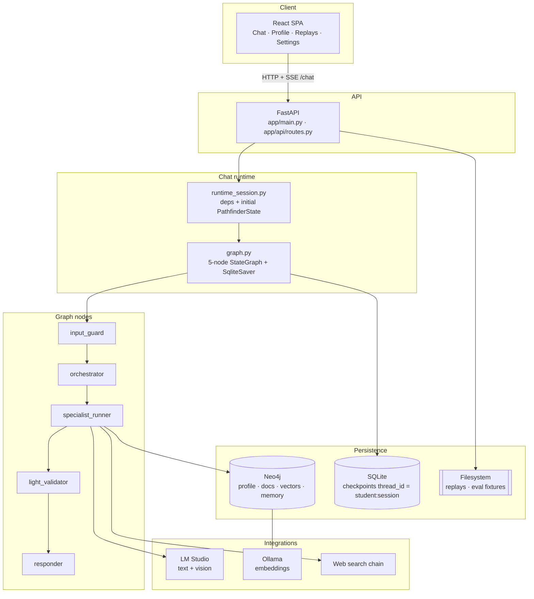
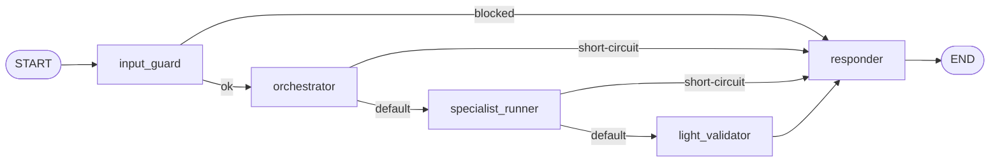
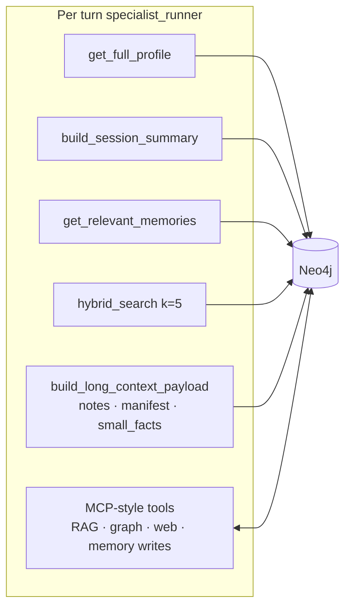

# Pathfinder: Current System Architecture

> Architecture reference for the Pathfinder codebase. For a **single end-to-end flow diagram** (every branch, tool surface, and SSE step), see [`PATHFINDER_ARCHITECTURE_FLOW.md`](PATHFINDER_ARCHITECTURE_FLOW.md).

Last updated: 2026-04-12

---

## 1. What Pathfinder Is

Local-first student advising stack: **FastAPI** backend, **React** UI, **LangGraph** chat workflow, **Neo4j** as durable profile and evidence store, **SQLite** LangGraph checkpoints, **LM Studio** + **Ollama** for inference/embeddings, optional **web search** chain, **replay/eval** on the filesystem.

---

## 2. System Layers



---

## 3. One Chat Turn (summary)

1. `POST /api/v1/chat` resolves `student_id` / `session_id`, optional document replace, validates uploads.
2. `build_chat_runtime_session()` records dependency snapshot and builds initial `PathfinderState`.
3. Compiled graph runs with config `thread_id = "{student_id}:{session_id}"`, `recursion_limit = 15`.
4. Route streams **SSE**: `progress` (from `step_progress`), `token` (word-split `final_answer`), then `done` (`build_done_payload`).
5. **Best-effort** after streaming: `persist_decision_record`, `build_replay_artifact` / `save_replay_artifact` (failures are logged; user answer is not rolled back).

---

## 4. LangGraph Workflow

Compiled in `app/core/graph.py`. Nodes live under `app/agents/`.



| Node | Role |
|---|---|
| `input_guard` | Empty / max length / SQL-injection-style patterns when topic guard is on. Sets `is_blocked` + `block_reason`. |
| `orchestrator` | Loads profile, builds session summary, **LLM scores** `academic` / `career` / `general` (fast `reasoning=none`), **heuristic fallback** if the LLM fails; boosts for files and certain `request_plan` hints; writes `routing_*` and `next_node`. |
| `specialist_runner` | Optional `doc_analyst` pre-ingest; reload profile; `get_relevant_memories`; `hybrid_search`; builds short + long context; **binds canonical tools** from `app/tools/registry.py`; agent loop with optional one-shot web-search retry nudge. |
| `light_validator` | Normalizes output, citations from successful `tool_call_log`, fixed confidence heuristic. |
| `responder` | Block path → `block_reason`; else `final_answer` ≈ `draft_answer`, minimal rewrite. |

**Not in this graph:** older multi-advisor branches, a dedicated `build_memory_pack` node. Retrieval strategy label from `execution_registry` (`memory_pack`) is metadata for settings/UI; live context is assembled inside `specialist_runner` and tools.

---

## 5. Runtime Decisions (quick reference)

| Area | Implementation |
|---|---|
| Workflow | `langgraph.graph.StateGraph` + `PathfinderState` (`app/core/state.py`) |
| Checkpointing | SQLite via `app/core/memory.py` |
| Tools | Same registry for chat and MCP (`app/tools/registry.py`, `app/mcp_server.py`) |
| Streaming | SSE from `POST /api/v1/chat` |
| Consolidation | Simplified vs older conflict UI; `maybe_consolidate_memory` after document/profile text paths |

---

## 6. Memory, Retrieval, and Long Context



- **Conversation continuity:** LangGraph checkpoints in SQLite, keyed by `student_id:session_id`.
- **Durable student memory:** Neo4j (entities, documents/chunks, candidate facts, memory items, evidence, recommendations).
- **Long context:** `app/services/long_context.py` — surfaced on Profile, editable `long_context_notes`, included in specialist payload. Consolidation: `app/services/consolidation.py`.

---

## 7. Neo4j and Ingestion (concise)

**Neo4j** (`app/adapters/neo4j/graph_store.py`): student lifecycle, full profile reads, entity/document CRUD, facts/memory/evidence/recommendations, graph export for UI.

**Ingestion:** PDF / image / DOCX via `doc_analyst` + `app/adapters/pdf/extractor.py`; free text via `app/services/profile_text.py`. Chat uploads: pre-ingest inside `specialist_runner`. Direct upload: `POST /api/v1/documents` calls `doc_analyst` then `maybe_consolidate_memory`.

---

## 8. Web Search

Provider order (fallback chain): **Tavily → Google CSE → Brave → DuckDuckGo**. Wired through `app/services/execution_registry.py` and `app/adapters/web_search/*`.

---

## 9. API Surface (prefix `/api/v1`)

| Group | Endpoints |
|---|---|
| Chat & ingest | `POST /chat`, `GET /documents/check`, `POST /documents`, `POST /profile/text` |
| Profiles | `GET`/`POST /profiles`, `GET`/`PUT /profile`, `DELETE /profile/entity/{label}/{name}`, `PUT /profile/entity`, `GET /profile/graph`, `DELETE /profile/reset` |
| Recommendations | `GET`/`POST /recommendations`, `PUT /recommendations/{recommendation_id}/outcome` |
| Sessions & replay | `GET /sessions`, `DELETE /sessions/{session_id}`, `PUT /sessions/{session_id}/promote-doc`, `GET /replays`, `GET /replays/{replay_id}`, `GET /replays/{replay_id}/evaluate`, `GET /replays/evaluate/recent`, `GET /eval/benchmarks`, `GET /eval/analytics` |
| Ops | `GET`/`PUT /settings`, `DELETE /settings/delete-all-data`, `GET /health`, `GET /background/status` |

---

## 10. Frontend

Router: `frontend/src/App.jsx` — routes `/chat`, `/profile`, `/replays`, `/settings`. API client: `frontend/src/services/api.js` (HTTP + SSE). Profile page shows long-context preview and edits `long_context_notes`.

---

## 11. MCP Server

`app/mcp_server.py` exposes the **same canonical tool set** as `specialist_runner` for external MCP clients.

---

## 12. Repository Layout

```text
app/
  api/          FastAPI routes
  agents/       LangGraph nodes (input_guard, orchestrator, specialist_runner, …)
  adapters/   Neo4j, LLM, embeddings, PDF, web search
  config/
  core/         graph, state, memory, quality helpers
  schemas/
  services/     runtime_session, consolidation, long_context, replay/eval, …
  tools/        canonical tool registry
  utils/
  main.py
  mcp_server.py

frontend/src/pages/    ChatPage, ProfilePage, ReplayPage, SettingsPage
tests/                 replay / benchmark fixtures
data/                  local artifacts
graphify-out/          generated graph reports
```

---

## 13. When You Change the System

Keep this file, [`PATHFINDER_ARCHITECTURE_FLOW.md`](PATHFINDER_ARCHITECTURE_FLOW.md), and these modules aligned:

- `app/core/graph.py`
- `app/core/state.py`
- `app/api/routes.py`
- `app/agents/orchestrator.py`
- `app/agents/specialist_runner.py`
