# Pathfinder Architecture Flow

This document explains what happens in Pathfinder from the moment a user sends a query until the final streamed answer is returned.

It is intentionally layered:
- Start with the end-to-end flow
- Then inspect the LangGraph runtime
- Then drill into the major subflows
- Use the file references to jump into implementation details

Key implementation entry points:
- API entry: `app/main.py`
- Route handler: `app/api/routes.py`
- Runtime assembly: `app/services/runtime_session.py`
- Graph assembly: `app/core/graph.py`
- Shared state: `app/core/state.py`

## 1. End-to-End Request-to-Response Flow

```mermaid
flowchart TD
    U["User sends chat query<br/>Optional: files, session_id, student_id, advisor_mode"] --> API["FastAPI app<br/>app/main.py"]
    API --> ROUTE["POST /api/v1/chat<br/>app/api/routes.py::chat()"]

    ROUTE --> SID["Resolve student_id<br/>Create session_id if missing"]
    SID --> REPLACE{"replace_filenames provided?"}
    REPLACE -- Yes --> DELDOC["Find matching uploaded docs<br/>Delete old document graph + chunks"]
    REPLACE -- No --> FILES["Continue"]
    DELDOC --> FILES["Validate and read uploads"]

    FILES --> RUNTIME["Build ChatRuntimeSession<br/>app/services/runtime_session.py"]
    RUNTIME --> HEALTH["Capture dependency snapshot<br/>neo4j / llm / embeddings / web_search"]
    HEALTH --> PLANHINT["Build deterministic RequestPlan"]
    PLANHINT --> POLICY["Evaluate runtime preflight policy"]
    POLICY --> STATE["Build initial PathfinderState"]

    STATE --> GRAPH["Compile LangGraph with SQLite checkpointer<br/>app/core/graph.py"]
    GRAPH --> STREAM["Run graph.astream(initial_state, config)"]

    STREAM --> GUARD["1. input_guard"]
    GUARD --> BLOCK{"Blocked?"}
    BLOCK -- Yes --> RESPBLOCK["responder returns block_reason"]
    BLOCK -- No --> ORCH["2. orchestrator"]

    ORCH --> EXEC["Execute planned node sequence<br/>0..N data/preparation nodes<br/>1 advisory node<br/>evaluator<br/>responder"]

    EXEC --> FINALSTATE["Accumulate final_state as each node emits updates"]
    FINALSTATE --> TOKENS["Split final_answer into words<br/>Stream SSE token events"]
    TOKENS --> DONEPAYLOAD["Build done payload<br/>confidence, citations, trace, recovery, runtime snapshot"]
    DONEPAYLOAD --> PERSIST1["Persist decision record"]
    PERSIST1 --> PERSIST2["Build + save replay artifact"]
    PERSIST2 --> SSE["Send SSE done event"]
    RESPBLOCK --> SSE
```

## 2. Runtime Layers

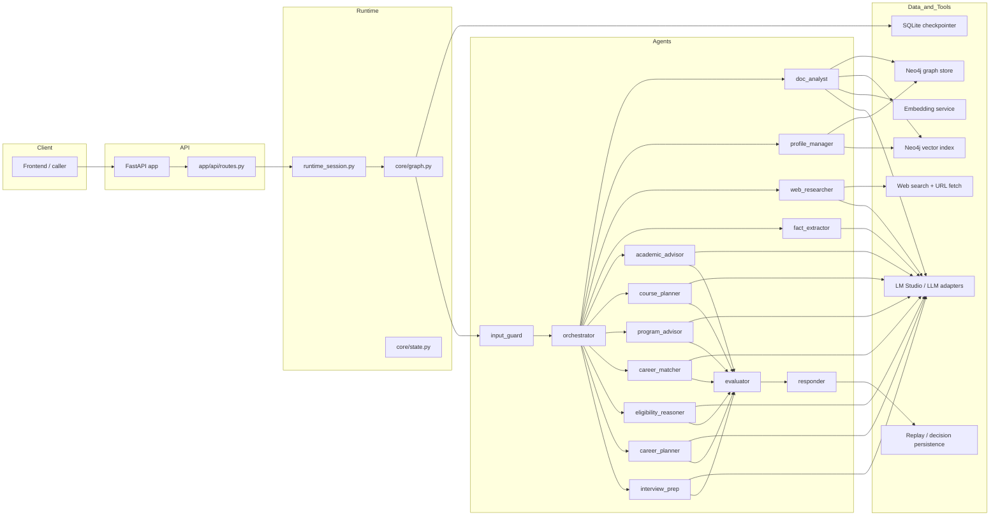

## 3. LangGraph Execution Flow

This is the runtime graph defined in `app/core/graph.py`.

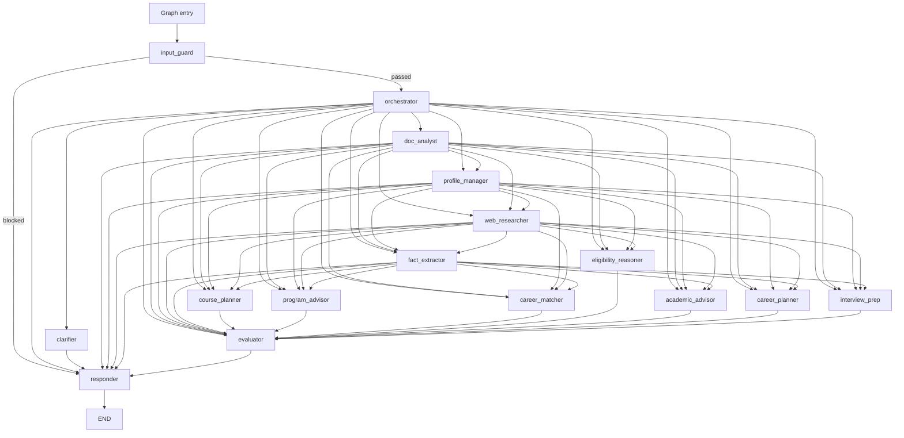

## 4. What Lives in `PathfinderState`

Every node reads and writes a shared state object defined in `app/core/state.py`.

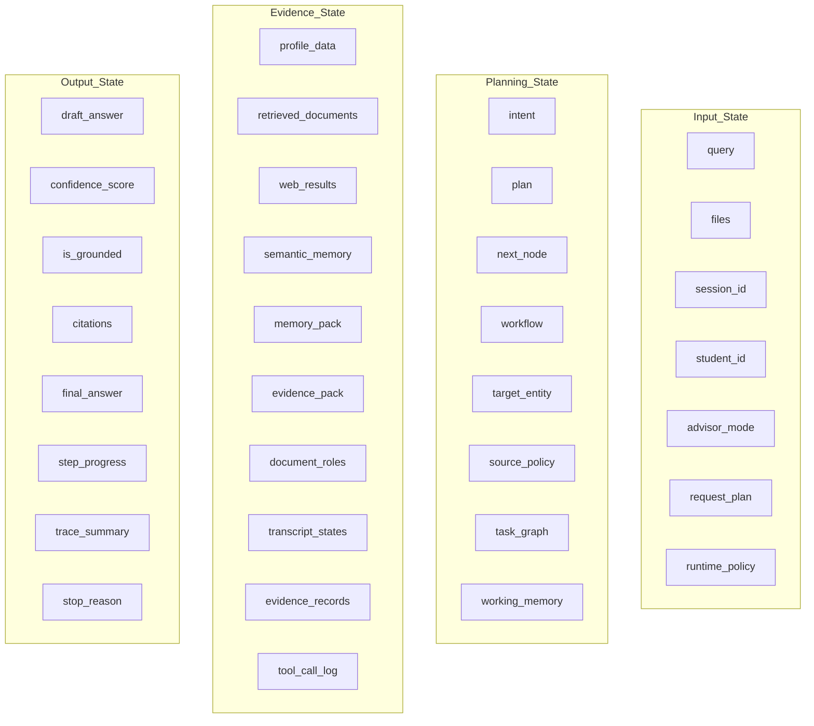

## 5. Detailed Flow: API Route + Runtime Session Setup

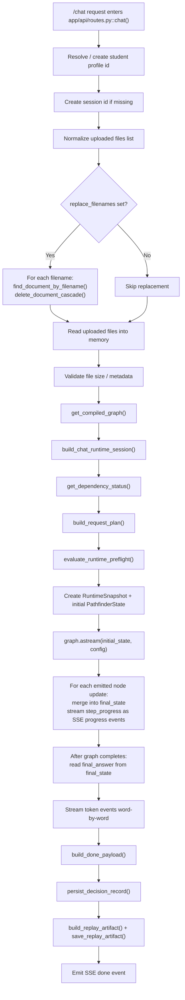

## 6. Detailed Flow: Deterministic Request Planner

This happens before the graph starts and gives the orchestrator a strong hint.

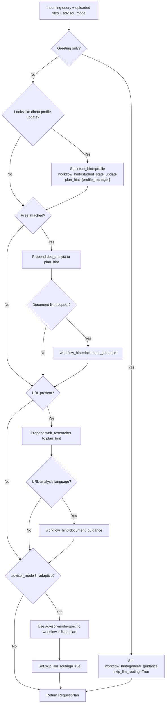

## 7. Detailed Flow: Input Guard

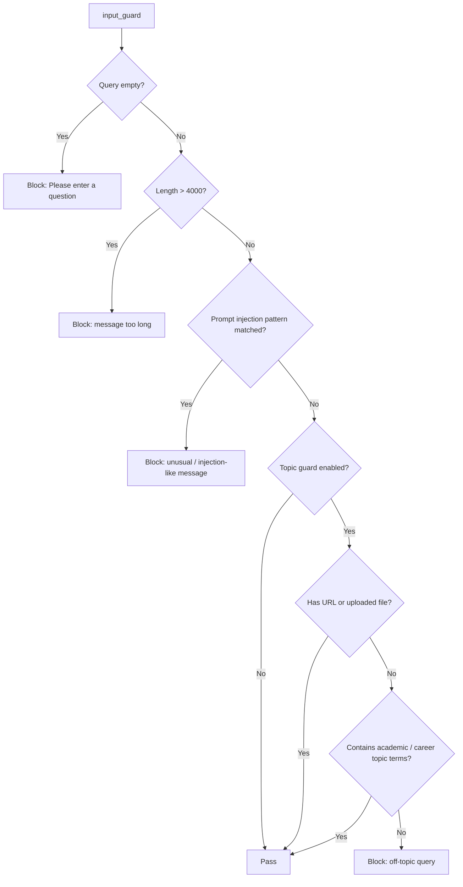

## 8. Detailed Flow: Orchestrator

The orchestrator is the main traffic controller.

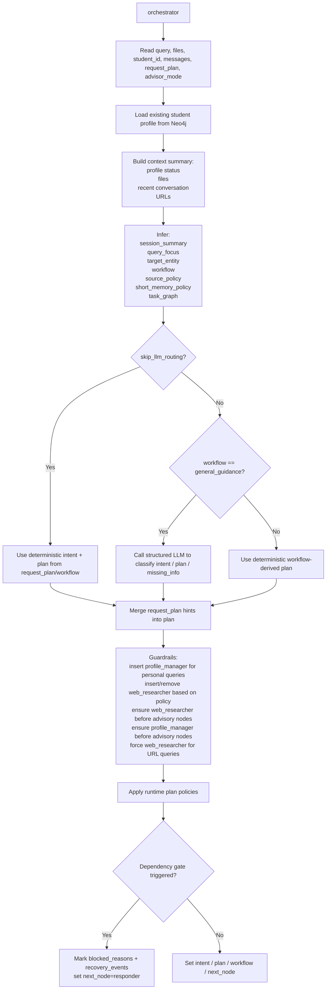

## 9. Detailed Flow: Document Ingestion Branch

This branch runs when files are attached or the planner routes to `doc_analyst`.

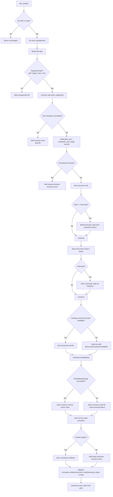

## 10. Detailed Flow: Profile + Memory Retrieval Branch

This is one of the most important branches because many downstream agents depend on it.

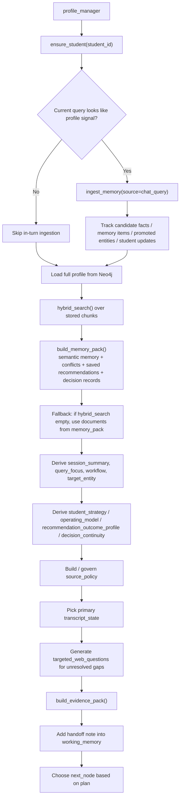

## 11. Detailed Flow: Web Research Branch

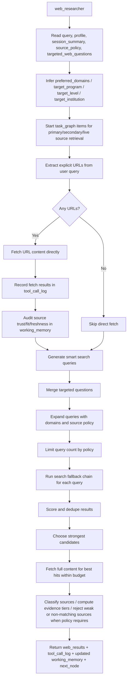

## 12. Detailed Flow: Advisory Node Layer

Exactly one or more preparation nodes may run, but the plan usually converges to one domain-specific advisory node before evaluation.

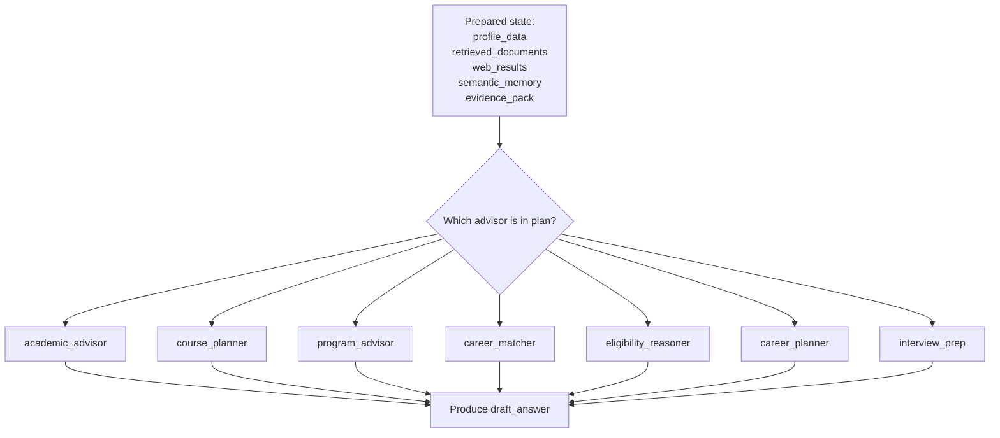

### 12.1 Example Detailed Subflow: `academic_advisor`

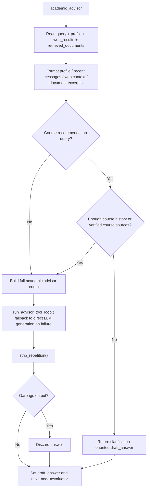

## 13. Detailed Flow: Evaluator

The evaluator is the quality gate between reasoning and user-visible output.

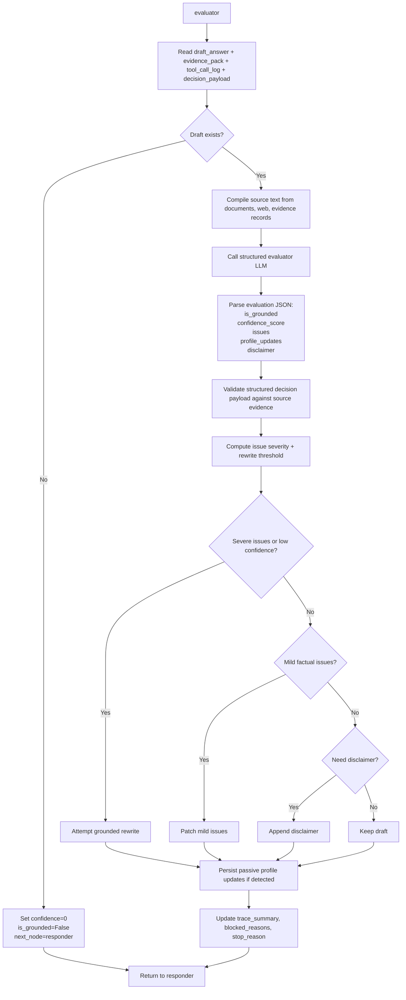

## 14. Detailed Flow: Responder

The responder decides whether to pass through a ready answer, synthesize one, or format a structured plan.

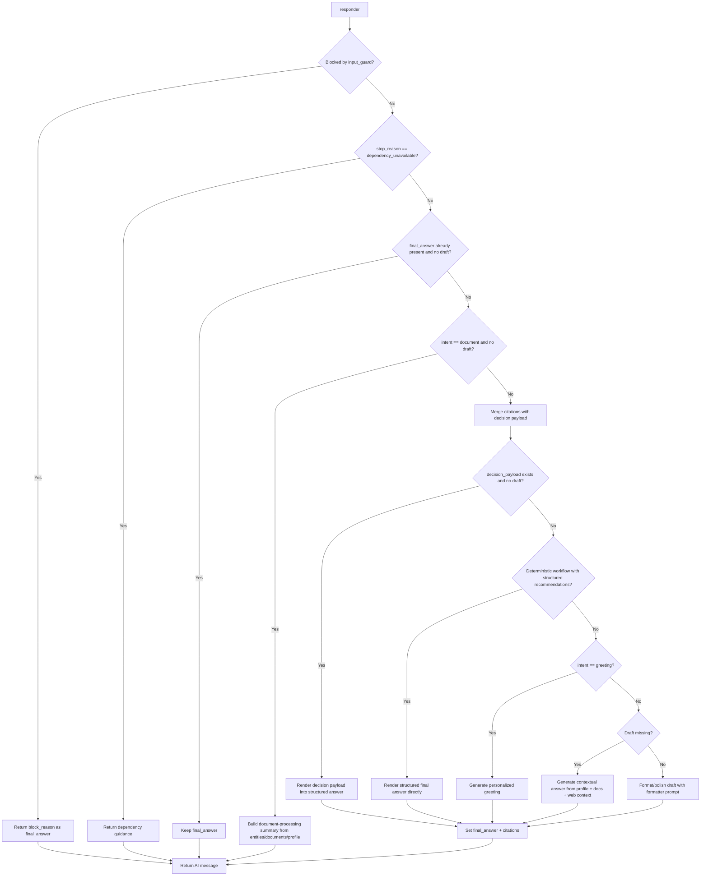

## 15. Persistence and Post-Response Artifacts

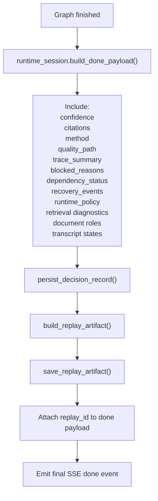

## 16. Startup and Background Flow

This is not part of a single query, but it affects runtime behavior.

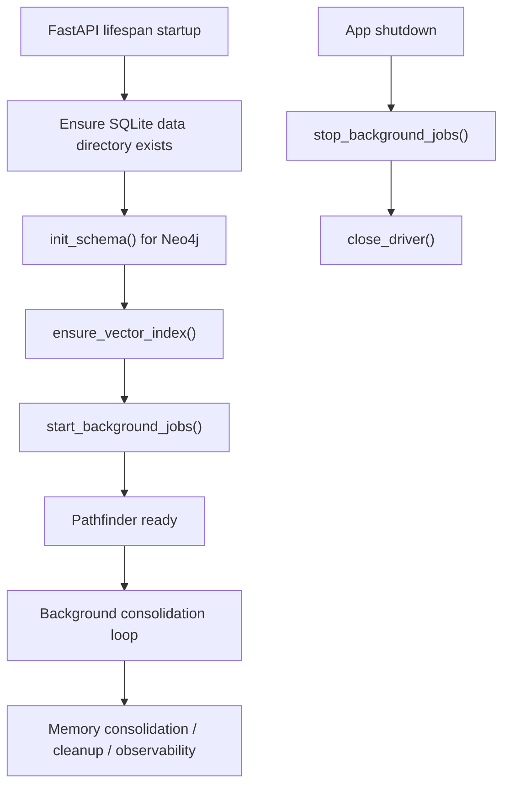

## 17. The Simplest Mental Model

If you want one sentence per stage, Pathfinder behaves like this:

1. The API route normalizes the request, files, student identity, and runtime settings.
2. The runtime session captures dependency health and builds deterministic planning hints.
3. The LangGraph state machine starts with safety validation.
4. The orchestrator decides what sequence of nodes is needed for this specific request.
5. Preparation nodes gather evidence from documents, profile memory, and the web.
6. One advisory node generates the first meaningful answer draft.
7. The evaluator checks whether that draft is grounded and good enough.
8. The responder turns the validated draft or structured payload into the final user-facing answer.
9. The route streams the answer back and stores replay/decision artifacts for debugging and evaluation.

## 18. File Map for Deeper Reading

- `app/main.py`
  FastAPI lifecycle, startup, shutdown, CORS, router registration.
- `app/api/routes.py`
  `/chat` SSE endpoint, upload handling, done payload persistence.
- `app/services/runtime_session.py`
  dependency checks, request planning, runtime snapshot, initial state, done payload.
- `app/services/request_planner.py`
  deterministic pre-routing for greetings, files, URLs, advisor modes, profile updates.
- `app/core/graph.py`
  LangGraph node registration and conditional routing.
- `app/core/state.py`
  the shared `PathfinderState` contract between all agents.
- `app/agents/input_guard.py`
  empty/length/injection/topic filtering.
- `app/agents/orchestrator.py`
  intent classification, workflow selection, plan shaping, dependency gating.
- `app/agents/doc_analyst.py`
  extraction, chunking, embeddings, entity extraction, transcript state generation.
- `app/agents/profile_manager.py`
  KG load, hybrid search, memory pack construction, student strategy derivation.
- `app/agents/web_researcher.py`
  URL fetch, query generation, web search, ranking, filtering, provenance logging.
- `app/agents/academic_advisor.py`
  example advisory node for academic guidance and tool-assisted drafting.
- `app/agents/evaluator.py`
  groundedness scoring, rewrite logic, issue handling, passive profile learning.
- `app/agents/responder.py`
  final formatting, structured rendering, fallback answer synthesis.
