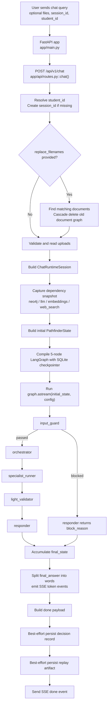
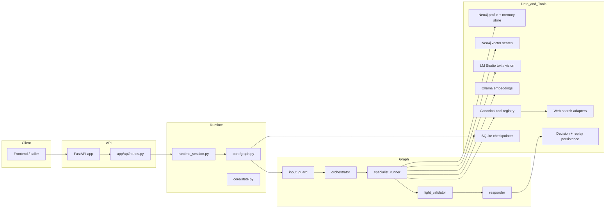
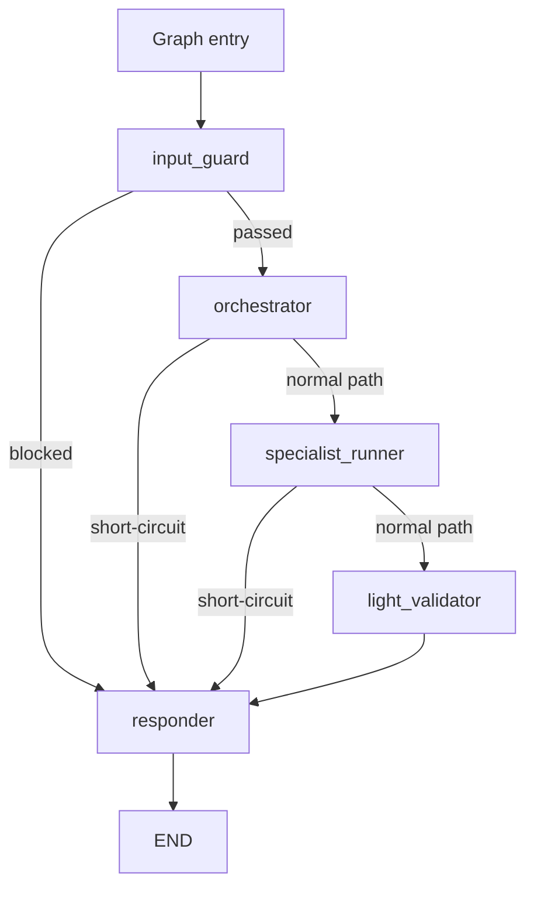
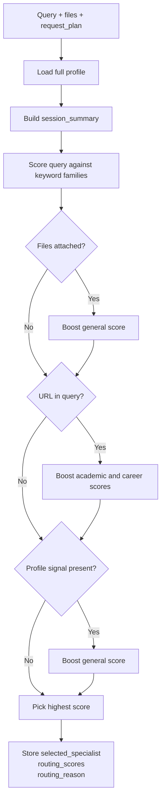
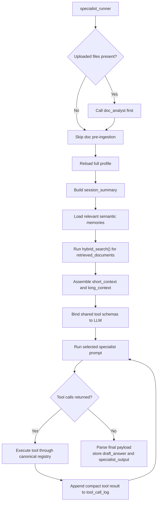
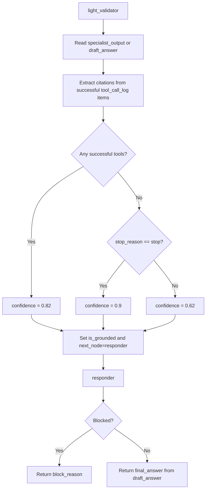

# Pathfinder Architecture Flow

This document describes the current live implementation of Pathfinder from request entry through final SSE output.

Key implementation entry points:

- API entry: `app/main.py`
- Route handler: `app/api/routes.py`
- Runtime assembly: `app/services/runtime_session.py`
- Graph assembly: `app/core/graph.py`
- Shared state: `app/core/state.py`
- Specialist execution: `app/agents/specialist_runner.py`

## 1. End-to-End Chat Flow

## 2. Runtime Layers

## 3. Current LangGraph Execution Flow

This is the runtime graph defined in `app/core/graph.py`.

### What each node does

- `input_guard`
  - blocks unsafe or out-of-scope requests
  - sets `is_blocked` and `block_reason` when needed

- `orchestrator`
  - loads the current profile
  - builds a session summary
  - scores the query against `academic`, `career`, and `general`
  - stores the selected specialist and routing explanation

- `specialist_runner`
  - pre-ingests uploaded files by calling `doc_analyst` when files are present
  - refreshes profile context with `get_full_profile(...)`
  - loads semantic memories with `get_relevant_memories(...)`
  - runs vector retrieval with `hybrid_search(...)`
  - invokes the selected specialist prompt with shared MCP-style tools
  - records tool provenance in `tool_call_log`

- `light_validator`
  - normalizes the specialist output
  - derives citations from successful tool calls
  - assigns a lightweight confidence score

- `responder`
  - returns the block reason for blocked turns
  - otherwise returns `draft_answer` as `final_answer` with minimal rewriting

## 4. Request Assembly Before The Graph Starts

`build_chat_runtime_session()` does the pre-graph setup:

- records dependency status for:
  - Neo4j
  - text LLM
  - embeddings
  - web search configuration
- stores the selected retrieval strategy label as `memory_pack`
- builds the initial request plan:
  - `reasoning`
  - `has_files`
  - `has_url`
- builds the initial state consumed by the graph

This is intentionally deterministic and lightweight. Most of the actual reasoning happens inside the selected specialist.

## 5. Specialist Selection Flow

The current specialist families are:

- `academic`
- `career`
- `general`

There is no longer a live graph branch that routes across many advisor nodes such as `profile_manager`, `web_researcher`, `academic_advisor`, or `evaluator`.

## 6. Specialist Execution Flow

Important implementation details:

- the specialist gets compact profile/session context, not the entire raw database payload
- the specialist can call tools for graph, memory, document, and web access
- retrieved documents and semantic memories are loaded before tool use begins
- uploaded file processing happens inside this node, not as a separate graph branch

## 7. Validation And Response Flow

## 8. Persistence After The Graph Finishes

After graph execution finishes inside `app/api/routes.py::chat()`:

1. progress messages are emitted as SSE `progress` events
2. the final answer is split into word-level SSE `token` events
3. `build_done_payload(...)` creates the terminal metadata payload
4. `persist_decision_record(...)` runs on a best-effort basis
5. a replay artifact is built and saved on a best-effort basis
6. the route emits a final SSE `done` event

Failures in decision-record or replay persistence are logged, but they do not fail the user-facing answer after the turn has already completed.

## 9. Long Context And Profile Memory

The profile/runtime bridge now centers on a shared long-context payload.

### What is included

The payload built by `app/services/long_context.py` includes:

- a manifest of graph entity types and document groups
- compact durable profile facts such as institution, program, semester, goals, and preferences
- editable `long_context_notes`

### Where it is used

- `specialist_runner` passes this payload into the selected specialist
- the replay artifact stores the payload so a turn can be inspected later
- the profile page shows a preview of the payload and lets the user edit `long_context_notes`

### Consolidation behavior

Consolidation still runs after:

- `POST /api/v1/profile/text`
- `POST /api/v1/documents`
- background consolidation scans

But the current implementation no longer exposes a separate profile-conflict API/UI flow. Instead, consolidation prefers the strongest supported fact and supersedes weaker conflicting candidates.

## 10. API Surface Relevant To Flow

### Chat runtime

- `POST /api/v1/chat`

### Direct ingestion

- `GET /api/v1/documents/check`
- `POST /api/v1/documents`
- `POST /api/v1/profile/text`

### Replay and evaluation

- `GET /api/v1/replays`
- `GET /api/v1/replays/{replay_id}`
- `GET /api/v1/replays/{replay_id}/evaluate`
- `GET /api/v1/replays/evaluate/recent`
- `GET /api/v1/eval/benchmarks`
- `GET /api/v1/eval/analytics`

## 11. Source Files To Read Next

For the current live implementation, start here:

- `app/api/routes.py`
- `app/services/runtime_session.py`
- `app/core/graph.py`
- `app/core/state.py`
- `app/agents/input_guard.py`
- `app/agents/orchestrator.py`
- `app/agents/specialist_runner.py`
- `app/agents/light_validator.py`
- `app/agents/responder.py`
- `app/services/consolidation.py`
- `app/services/long_context.py`
